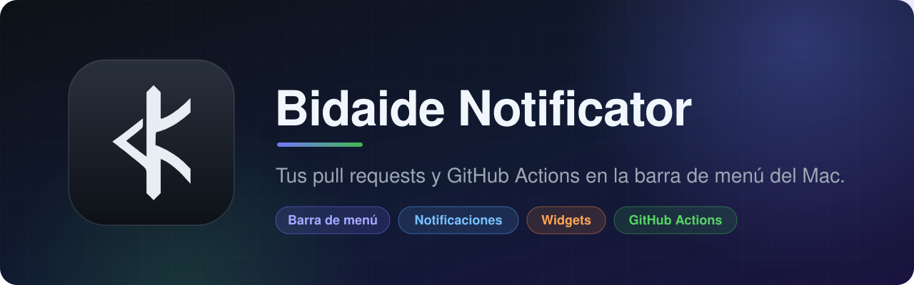
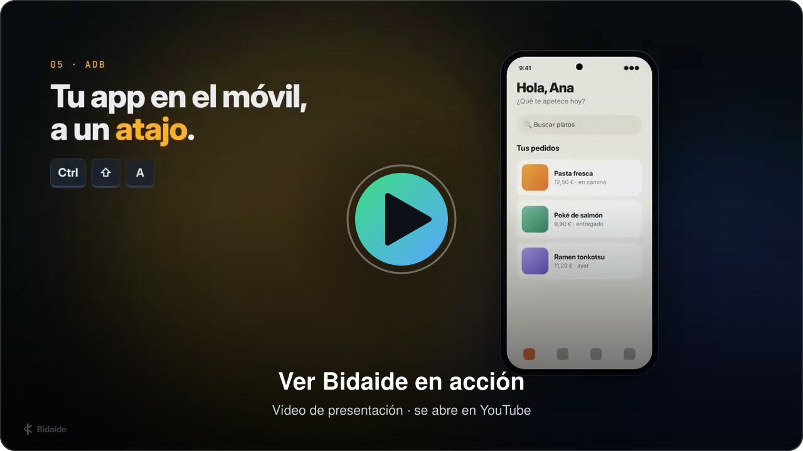

<p align="center">
  
</p>

<p align="center">
  
  
  
  
  <a href="LICENSE"></a>
  
</p>

<h3 align="center">Revisa pull requests y maneja tu dispositivo sin salir de Android Studio.</h3>

<p align="center">
  <a href="https://youtu.be/2NdpDKRjDK8"><b>▶ Vídeo</b></a> ·
  <a href="#-instalación"><b>Instalar</b></a> ·
  <a href="#-github">GitHub</a> ·
  <a href="#-adb">ADB</a> ·
  <a href="#-atajos">Atajos</a> ·
  <a href="#%EF%B8%8F-configuración">Configuración</a> ·
  <a href="#-preguntas-frecuentes">Preguntas</a>
</p>

---

**Bidaide** junta en un solo plugin las dos cosas que más te sacan del IDE:

- 🐙 **GitHub**, a través de la [GitHub CLI](https://cli.github.com) que ya tienes instalada. Pull requests con
  revisión línea a línea, issues, Actions, releases, notificaciones y más.
- 🤖 **ADB**, con un popup de operaciones rápidas sobre la app en la que estás trabajando. Limpiar datos,
  deep links, capturas, logcat, bases de datos, perfiles de dispositivo.

Sin tokens que configurar: el plugin usa la sesión de `gh`. Sin navegador: todo ocurre en el IDE.

> [!NOTE]
> Versión 0.1.0, en beta. Funciona, pero es joven: si algo falla, abre una issue.

## 🎬 Míralo en acción

<p align="center">
  <a href="https://youtu.be/2NdpDKRjDK8" title="Ver el vídeo de Bidaide en YouTube">
    
  </a>
</p>

<p align="center">
  <a href="https://youtu.be/2NdpDKRjDK8"></a>
</p>

## ✨ Lo más destacado

| | |
|---|---|
| 🔍 **Revisión de PR en el IDE** | El diff de Android Studio con los hilos bajo cada línea. Comenta, sugiere cambios, resuelve y envía la review. |
| ✅ **Archivos vistos** | La misma casilla *Viewed* de github.com, sincronizada. |
| 🚦 **PR de tu rama en la barra de estado** | Checks, estado de review e hilos abiertos de un vistazo. |
| 🛡️ **¿Puedo fusionar?** | Qué exige la rama base y qué te falta: aprobaciones, checks obligatorios, conversaciones. |
| 🗂️ **Tablero de issues** | Columnas por label, asignado, milestone o estado, con arrastrar y soltar. |
| 📦 **Del CI al dispositivo** | Descarga el APK de un run o de una release y lo instala. |
| ⌨️ **ADB con un atajo** | Más de 50 operaciones en un popup con búsqueda. |
| 🗄️ **Datos de la app** | Edita SharedPreferences y explora las bases de datos con SQL. |
| 🐞 **Informe de bug en un clic** | Captura, logcat y datos del dispositivo directos a una issue. |

## 📥 Instalación

### Requisitos

- **Android Studio 2026.1** (build 261) o posterior.
- **GitHub CLI** con sesión iniciada:

  ```sh
  brew install gh
  gh auth login
  ```

- Para la parte de ADB: un dispositivo o emulador conectado. Nada más.

### Instalar el plugin

1. Descarga `bidaide-<versión>.zip` de la página de [**Releases**](../../releases/latest).
2. En Android Studio: **Settings → Plugins → ⚙ → Install Plugin from Disk...**
3. Elige el zip y reinicia el IDE.

Al abrir un proyecto con un remoto de GitHub aparece la ventana **Bidaide** en la parte inferior.

> [!TIP]
> ¿Tu proyecto tiene varios remotos? Pulsa el icono de GitHub de la barra de la ventana y elige cuál usar.
> Es lo mismo que `gh repo set-default`.

## 🐙 GitHub

Todo vive en la ventana **Bidaide**, una pestaña por tema. Cada pestaña se carga la primera vez que la abres.

### Pull requests

- **Lista** al estilo de github.com: título con sus labels, quién la abrió y cuándo, ramas, estado de review y de
  checks, avatares de quien la tiene asignada y última actividad. Con filtro por estado, filtros rápidos (mías,
  pendientes de mi review, asignadas, me mencionan) y búsqueda con la sintaxis de GitHub.
- **Crear**: título y cuerpo salen de tus commits o de `PULL_REQUEST_TEMPLATE.md`. Reviewers, asignados, labels,
  borrador. Hace push de la rama antes.
- **Autor y reviewers con su avatar** de GitHub, y el estado de cada review (aprobó, pidió cambios, pendiente).
- **Requisitos para fusionar**: una lista con ✓ y ✗ de lo que exige la rama base. Aprobaciones que faltan, checks
  obligatorios, conversaciones sin resolver, rama al día, conflictos. Lee rulesets y protección de rama.
- **Detalle** con la actividad completa en orden: comentarios, reviews, commits, labels, cierres.
- **Acciones**: checkout, aprobar, pedir cambios, comentar, marcar lista, actualizar rama (merge o rebase),
  merge con auto-merge opcional, editar labels / asignados / reviewers / milestone, cerrar y reabrir.
- **Probar en dispositivo**: elige cómo. *En un worktree aparte* (por defecto) baja la PR a una carpeta propia del
  IDE sin tocar tu rama ni tus cambios, la compila con Gradle (tu módulo de app y variante, tu JDK de Gradle y una
  copia de tu `local.properties`), la instala y la abre en el dispositivo; la build sale en una pestaña de la
  ventana Bidaide. Los archivos que no están en git (`google-services.json`, claves...) no se copian. *Checkout en tu
  copia* hace checkout de la PR y lanza tu run configuration, y avisa si tienes cambios sin commit. Los worktrees se
  borran con *Tools → Bidaide → GitHub → Borrar worktrees de PRs*.
- **APK del CI**: descarga el artifact del último run de la rama y ofrece instalarlo.

### Revisión de código

**Revisar cambios** abre una ventana propia:

- 🌳 **Árbol de archivos** con vistos y número de conversaciones, y **lista de conversaciones**. Doble clic te
  lleva al hilo.
- 💬 **Hilos bajo su línea** en el diff del IDE: responder, resolver, reabrir, editar, borrar, reaccionar.
- ✍️ **Comentar** una línea o una selección. *Comentar ahora* publica al momento; *Iniciar review* lo deja
  pendiente hasta que pulses **Enviar review** (comentar, aprobar o pedir cambios).
- 💡 **Sugerencias**: *Insertar sugerencia* crea el bloque `suggestion`; *Aplicar sugerencia* crea el commit
  directamente en GitHub, como el botón de la web. No toca tus archivos locales.
- ☑️ **Cambios vistos uno a uno**: una casilla junto a cada cambio, como al preparar un commit. Al marcar el
  último, el archivo pasa a *Visto*; al marcar el archivo, se marcan todos sus cambios.
- 🧩 **Commit a commit**: un desplegable cambia entre todos los cambios y cada commit.
- ⚡ **Respuestas guardadas** para los comentarios que repites.
- 🕰️ **Hilos obsoletos** (el código ya cambió) en un popup desde la lista.

### Mientras programas

- **Barra de estado**: la PR de tu rama con checks, review e hilos abiertos. Clic para acciones, entre ellas
  **¿Cumple los requisitos de merge?**
- **Margen del editor**: un globo en las líneas que tienen conversación.
- **Avisos**: te piden review, aprueban o piden cambios en tu PR, tus checks fallan o pasan.

### Issues

Lista al estilo de github.com: título con sus labels, quién la abrió y cuándo, PR que la cierran, avatares de
los asignados y última actividad. El detalle lleva cabecera con estado, labels, autor y asignados.

Crear, comentar, cerrar, reabrir y editar labels / asignados / milestone. **Crear rama** enlazada a la issue.

**Tablero**: el botón *Ver como tablero* cambia la lista por columnas de tarjetas, agrupadas por label, asignado,
milestone o estado. Arrastra una tarjeta a otra columna y la issue cambia en GitHub. Desde el editor, **Crear issue desde selección**: un `TODO` pasa a ser el título y el cuerpo lleva el
enlace permanente al código.

### Actions

Runs de tu rama o de todas, con refresco automático mientras algo corre.

- Relanzar todo o solo lo fallido, cancelar.
- **Logs** en su pestaña, con las rutas de archivo enlazadas a tu código local.
- **Artifacts**: descargar e instalar el APK.
- **Lanzar workflow** con `workflow_dispatch` y sus parámetros.

### Y además

| Pestaña | Qué hace |
|---|---|
| **Releases** | Crear (tag, notas automáticas, borrador, pre-release), publicar, borrar, descargar archivos. |
| **Bandeja** | Tus notificaciones como en github.com: vistas por motivo (asignadas, menciones, review solicitada) y por repositorio, todas o sin leer, búsqueda. Marcar leída, archivar, dejar de seguir. |
| **Discussions** | Listar, leer con respuestas, comentar, crear. |
| **Projects** | Tablero con una columna por estado; arrastra tarjetas entre columnas, añade issues o PR. |

En el **editor** (clic derecho → *Bidaide GitHub*): abrir en GitHub, copiar enlace permanente, crear gist y
**¿Qué PR trajo esta línea?**

En **Tools → Bidaide → GitHub**: buscar código en GitHub, cambiar de cuenta, clonar un repositorio y publicar
el proyecto.

## 🤖 ADB

Pulsa el atajo y escribe: el popup filtra mientras tecleas. También en **Tools → Bidaide → ADB**.

| Grupo | Operaciones |
|---|---|
| **App** | Desinstalar · matar · iniciar · reiniciar · limpiar datos · limpiar caché · reinstalar · instalar APK · iniciar con depurador · conceder y revocar permisos |
| **Probar** | Deep links con historial · enviar texto al campo con foco · captura de pantalla · grabación de pantalla · logcat solo de tu app · informe de bug a issue |
| **Ajustes** | Modo oscuro · fuente grande · idioma de la app · animaciones · «No mantener actividades» · mostrar toques · girar pantalla |
| **Condiciones** | Modo avión · Wi-Fi · datos móviles · batería baja · Doze · matar el proceso en segundo plano · ubicación GPS · red lenta |
| **Datos** | Editar SharedPreferences · explorar bases de datos con SQL · extraer datos · guardar y restaurar el estado de la app |
| **Conexión** | Emparejar por Wi-Fi · `adb reverse` |

### Hecho a tu medida

- **Comandos propios**: define en Settings los tuyos (`Nombre = comando`, con `{package}` como id de la app) y
  aparecen en el popup.
- **Perfiles de dispositivo**: varios ajustes de golpe.

  ```
  Accesibilidad = dark=on, font=1.3, animations=off
  Árabe = locale=ar, rotation=portrait
  Normal = dark=off, font=1.0, animations=on, rotation=auto
  ```

- **Varios dispositivos**: pregunta una vez (incluye *Todos los dispositivos*) y lo recuerda.

## ⌨ Atajos

| Acción | macOS | Windows / Linux |
|---|---|---|
| Popup de operaciones ADB | <kbd>Ctrl</kbd> <kbd>Shift</kbd> <kbd>A</kbd> | <kbd>Ctrl</kbd> <kbd>Alt</kbd> <kbd>Shift</kbd> <kbd>A</kbd> |
| Comentar la línea en la PR (en el diff) | <kbd>Ctrl</kbd> <kbd>Alt</kbd> <kbd>C</kbd> | <kbd>Ctrl</kbd> <kbd>Alt</kbd> <kbd>C</kbd> |
| Enviar el comentario | <kbd>⌘</kbd> <kbd>Enter</kbd> | <kbd>Ctrl</kbd> <kbd>Enter</kbd> |

Todos se pueden cambiar en **Settings → Keymap**, buscando `Bidaide` o `ADB:`.

## ⚙️ Configuración

**Settings → Tools → Bidaide**

| Ajuste | Para qué |
|---|---|
| Ruta de `gh` | Solo si no está en una ruta habitual. El botón *Comprobar* te dice si hay sesión. |
| Avisos de GitHub | Activarlos y cada cuántos minutos consultar. |
| Respuestas guardadas | `Nombre = texto`, una por línea. `\n` es un salto de línea. |
| Carpeta de capturas | Dónde van capturas, grabaciones y datos extraídos. Por defecto, el Escritorio. |
| Comandos propios | `Nombre = comando shell`, uno por línea. |
| Perfiles de dispositivo | `Nombre = clave=valor, clave=valor`, uno por línea. |

<details>
<summary><b>Claves de los perfiles de dispositivo</b></summary>

| Clave | Valores |
|---|---|
| `dark`, `animations`, `touches`, `dontkeep`, `wifi`, `data` | `on` / `off` |
| `font` | Escala, por ejemplo `1.3` |
| `rotation` | `portrait` / `landscape` / `auto` |
| `locale` | Idioma de la app, por ejemplo `ar` o `es-ES`; `system` para volver al del sistema |

</details>

## ❓ Preguntas frecuentes

<details>
<summary><b>¿Dónde guarda el plugin mi token de GitHub?</b></summary>

En ningún sitio. Cada operación ejecuta `gh`, que usa la sesión que dejaste con `gh auth login`.
</details>

<details>
<summary><b>¿«Aplicar sugerencia» toca mis archivos locales?</b></summary>

No. El commit se crea en GitHub a través de la API, igual que el botón de la web: no hay commit local, ni push,
ni cambios en tu copia de trabajo. Si tienes esa rama en local, quedará un commit por detrás hasta que hagas
pull. Antes de crear el commit el plugin pide confirmación, y se niega si el archivo cambió en la rama desde que
abriste la revisión.
</details>

<details>
<summary><b>«Requisitos para fusionar» dice que no pudo leer las reglas</b></summary>

GitHub no expone los rulesets de repositorios privados en planes gratuitos. El resultado sigue siendo válido:
usa lo que GitHub indica en la propia PR (decisión de review, qué checks son obligatorios, estado de merge), pero
no puede decirte cuántas aprobaciones se exigen.
</details>

<details>
<summary><b>La pestaña Projects da un error de permisos</b></summary>

`gh` necesita un permiso extra para Projects. Ejecuta una vez en una terminal:

```sh
gh auth refresh -s project
```
</details>

<details>
<summary><b>«No default remote repository has been set»</b></summary>

El proyecto tiene varios remotos y `gh` no sabe cuál usar. Pulsa el icono de GitHub en la barra de la ventana
Bidaide y elige el repositorio.
</details>

<details>
<summary><b>Limpiar caché, preferencias o bases de datos fallan</b></summary>

Esas operaciones entran en la carpeta privada de la app con `run-as`, que Android solo permite en builds
depurables. Con una build de release no funcionan.
</details>

<details>
<summary><b>El atajo de ADB no hace nada, o abre otro popup</b></summary>

Es el mismo atajo que usa ADB Idea. Si tienes los dos plugins, desactiva ADB Idea o cambia el atajo en
Settings → Keymap.
</details>

<details>
<summary><b>¿Qué operaciones solo funcionan en emulador?</b></summary>

La ubicación GPS y la red lenta: usan la consola del emulador, que los dispositivos físicos no tienen.
</details>

<details>
<summary><b>¿Por qué el informe de bug no adjunta la captura?</b></summary>

GitHub no permite subir imágenes por API. La captura queda en el portapapeles y en tu carpeta de capturas:
pégala en la issue desde github.com.
</details>

<details>
<summary><b>Otros límites que conviene saber</b></summary>

- Los comentarios en línea se escriben sobre «Todos los cambios»; la vista commit a commit es de solo lectura.
- El logcat sigue al proceso de la app: si la reinicias, vuelve a lanzarlo.
- *Enviar texto* solo admite caracteres ASCII, sin tildes ni emojis.
- El idioma por app necesita Android 13 o posterior.
- Cambiar de cuenta de GitHub es global: también afecta a `gh` en la terminal.
- Los globos del editor usan las líneas de la PR en GitHub; con cambios locales sin subir pueden desplazarse.
</details>

## 🛠 Desarrollo

```sh
./gradlew test          # tests unitarios
./gradlew runIde        # Android Studio de pruebas con el plugin
./gradlew buildPlugin   # build/distributions/bidaide-<versión>.zip
```

El build compila contra el Android Studio local indicado en `gradle.properties` (`androidStudioPath`) y usa su
JBR 21. Para abrir un segundo IDE de pruebas mientras hay otro en marcha:

```sh
./gradlew runIde -PsandboxDir=build/otro-sandbox
```

## 📄 Licencia

Copyright 2026 David Arribas.

Bidaide se distribuye bajo la [Licencia Apache 2.0](LICENSE): puedes usarlo, modificarlo y redistribuirlo, también
con fines comerciales, conservando el aviso de copyright y la licencia. El nombre y el logotipo de Bidaide no
están incluidos en esa concesión.

---

<p align="center">
  Hecho por <b>David Arribas</b> · Kotlin · IntelliJ Platform
</p>
