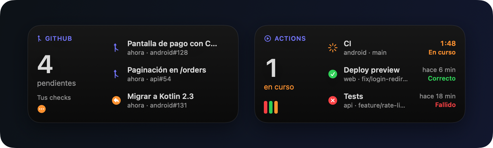

<p align="center">
  
</p>

<p align="center">
  <a href="https://github.com/DavidUps/bidaide/releases/latest"></a>
  
  
  <a href="https://github.com/DavidUps/bidaide/actions/workflows/build.yml"></a>
</p>

<h3 align="center">Lo que te espera en GitHub, sin abrir el navegador.</h3>

<p align="center">
  
</p>

## Instalar

```sh
curl -fsSL https://raw.githubusercontent.com/DavidUps/bidaide/main/install.sh | sh
```

Solo necesitas macOS 14 y haber iniciado sesión con `gh auth login`. Para actualizar, vuelve a ejecutarlo.

<details>
<summary>Con Homebrew</summary>

```sh
brew install --cask davidups/tap/bidaide-notificator
```

Actualizar: `brew upgrade --cask bidaide-notificator` · Desinstalar: `brew uninstall --cask --zap bidaide-notificator`
</details>

## Qué hace

|  |  |
|---|---|
| 🔢 **Barra de menú** | Cuántas PR te esperan y la lista por secciones: revisar, responder, comentadas, asignadas, las tuyas y tus Actions. |
| 🔔 **Notificaciones** | Revisiones pedidas, comentarios, menciones y Actions que fallan, con el texto del comentario y su sonido propio. |
| 🧩 **Widgets** | *Pull requests* y *GitHub Actions*, en cuatro tamaños. Clic derecho en el escritorio → *Editar widgets*. |
| 🔒 **Sin tokens** | Todo pasa por [GitHub CLI](https://cli.github.com) con tu sesión de `gh`; la app no guarda nada. |

Clic en una PR o run para abrirla; clic derecho para copiar el enlace o marcarla como leída. En **Ajustes** eliges cada
cuánto consultar, qué notificaciones quieres y si arranca al iniciar sesión.

## Desarrollo

<details>
<summary>Compilar, estructura y publicar versiones</summary>

Necesitas Xcode y [XcodeGen](https://github.com/yonaskolb/XcodeGen).

```sh
xcodegen generate                    # genera el proyecto desde project.yml
./scripts/install-from-source.sh     # compila en Release, instala en ~/Applications y la abre
```

- `App/`: menú, ajustes, `GhCli` (ejecuta `gh`), `GitHubService` (PR, notificaciones y Actions), `AppModel` (sondeo y
  notificaciones).
- `Widget/`: los dos widgets. Están en sandbox y no pueden ejecutar `gh`: leen el
  `~/Library/Application Support/BidaideNotificator/snapshot.json` que escribe la app.
- `Shared/`: modelos y `SnapshotStore`.
- Icono: `swift scripts/make-icon.swift`, a partir del logo del plugin (`packaging/icon/glyph.svg`).

**Publicar:** sube `MARKETING_VERSION` en `project.yml` y crea el tag (`git tag v0.3.0 && git push origin v0.3.0`). El
workflow `Release` compila y publica la release; si existe el secreto `TAP_TOKEN` también actualiza el cask de
[homebrew-tap](https://github.com/DavidUps/homebrew-tap).
</details>
